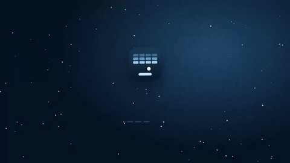

<!-- ENS:TANITIM -->
## 🎬 Tanıtım

Tam kalitede izlemek için görsele tıkla · MP4, 32 saniye

<!-- /ENS:TANITIM -->

Kartopunu kızağınla sektir, buz bloklarını kır! Tuğla kırma oyunu; telefonda parmakla, bilgisayarda fare ya da ok tuşlarıyla oynanır.

**[→ Hemen oyna](https://enskygr234.github.io/buz-kirici/)**

## Neler var?

- **8 bölüm**, sonra bloklar daha dayanıklı hâlde yeniden başlar. Açık mavi bloklar tek, koyular iki-üç vuruşta kırılır; gri demir buz hiç kırılmaz.
- **Güçlendirmeler:** ↔ geniş kızak · ×3 üç kartopu · 🐢 yavaş top · ♥ fazladan can · 🔥 kor topu (blokların içinden geçer). ✦ işaretli bloklardan kesin güç çıkar.
- Kızağın neresine değdiğine göre top farklı açıyla seker: ortası dik, kenarları yatık.
- Kırılan buz parçaları, ekran sarsıntısı, kodla üretilen ses efektleri (🔊 ile kapat).
- Rekor tarayıcıda saklanır; başka sekmeye geçince oyun durur.

## Kontroller

| | Telefon | Bilgisayar |
|---|---|---|
| Kızağı oynat | Parmağını kaydır | Fare ya da ← → / A D |
| Topu fırlat | Dokun | Boşluk ya da tıkla |
| Duraklat | — | P ya da Esc |
| Ses | 🔊 simgesi | M |

## Telefona kur

- **Ana ekrana ekle (şimdi):** Telefonda Chrome ile [https://enskygr234.github.io/buz-kirici/](https://enskygr234.github.io/buz-kirici/) adresini aç → sağ üstteki **⋮** → **Ana ekrana ekle**. Oyun uygulama gibi tam ekran açılır ve internetsiz de çalışır.
- **APK:** [Buradan indir](https://github.com/Enskygr234/buz-kirici/releases/download/son-surum/BuzKirici.apk), dosyayı aç ve kur. Telefon ilk seferde "bilinmeyen kaynaklardan yükleme" izni isteyebilir. Her güncellemede GitHub Actions yeni APK'yı kendiliğinden derler.

## Teknik

Tek `canvas`, saf JavaScript; görsel ve ses dosyası yok, her şey kodla çiziliyor ve üretiliyor. Hızlı top blokların içinden geçmesin diye her karede küçük adımlarla ilerletiliyor.

## Lisans

[MIT](LICENSE) © Winterdeveloper

<!-- ENS:ALT -->
---

**❄️ ENS Developer'ın diğer projeleri**

🎮 Oyunlar: [Mahalle](https://github.com/Enskygr234/mahalle) · [Ayaz Ata'nın Feneri](https://github.com/Enskygr234/ensdewloper.github.io/tree/main/ayaz-feneri) · [Kayıp Fener](https://github.com/Enskygr234/kayip-fener) · [Son Kış](https://github.com/Enskygr234/son-kis) · [Ayazle](https://github.com/Enskygr234/ayazle) · [Kar Birleştir](https://github.com/Enskygr234/kar-birlestir)

[🌐 Bütün projeler](https://enskygr234.github.io/ensdewloper.github.io/) · [👤 GitHub profilim](https://github.com/Enskygr234)

Kış gelir, kod yazılır.

<!-- /ENS:ALT -->
